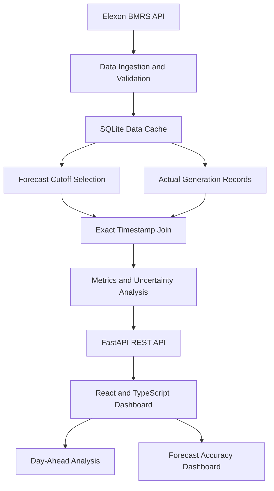

# WindLens — Day-Ahead Wind Forecast Intelligence

**A data-driven forecasting and accuracy analysis platform for UK wind generation.**

[](https://windforecastapp.onrender.com/)
[](https://www.python.org/)
[](https://fastapi.tiangolo.com/)
[](https://react.dev/)
[](https://www.typescriptlang.org/)
[](https://bmrs.elexon.co.uk/)

**Live Application:** https://windforecastapp.onrender.com/

WindLens is a day-ahead wind forecast intelligence application designed to help UK electricity buyers and analysts understand what wind generation forecasts were available at a specified decision cutoff and how accurately those forecasts predicted actual generation.

The application combines historical analysis, forecast selection based on publication timestamps, forecast-versus-actual comparisons, and a rolling view of current and upcoming delivery days. It uses national wind generation data from **Elexon BMRS** and provides interactive dashboards and a REST API.

> **Important:** WindLens is a decision-support and analytical demonstration, not a real-time electricity market feed, demand forecasting system, dispatch tool, or procurement recommendation engine.

## Table of Contents

- [Project Overview](#project-overview)
- [Live Demo](#live-demo)
- [Key Features](#key-features)
- [Dashboard Capabilities](#dashboard-capabilities)
- [Data Source and API](#data-source-and-api)
- [Forecast Selection Methodology](#forecast-selection-methodology)
- [Forecast Accuracy Metrics](#forecast-accuracy-metrics)
- [Technology Stack](#technology-stack)
- [System Architecture](#system-architecture)
- [Project Structure](#project-structure)
- [Getting Started](#getting-started)
- [Environment Configuration](#environment-configuration)
- [Testing and Code Quality](#testing-and-code-quality)
- [Deployment](#deployment)
- [Limitations and Future Improvements](#limitations-and-future-improvements)
- [Author](#author)
- [Acknowledgements](#acknowledgements)

## Project Overview

Wind generation forecasts can change as new information becomes available. Evaluating forecast accuracy therefore requires more than comparing the latest forecast with actual generation: it requires reconstructing the forecast that was available at the decision-making deadline.

WindLens addresses two core questions:

1. **Decision-time forecast:** What wind generation forecast had been published by the configured cutoff for a selected delivery day?
2. **Forecast performance:** How closely did that forecast match actual wind generation, and how did its error vary by hour of day and forecast horizon?

The project preserves the January 2026 historical challenge pilot while extending the application with rolling historical data, upcoming delivery dates, periodic source refreshes, and interactive accuracy analysis.

### Intended use cases

- Evaluate day-ahead wind generation forecast accuracy.
- Compare forecasts against observed generation.
- Identify hours with higher forecast errors.
- Investigate forecast bias and uncertainty.
- Examine how forecast error changes with forecast horizon.
- Demonstrate reliable time-series ingestion, data validation, analytics, and full-stack application development.

## Live Demo

**Open the deployed application:** [https://windforecastapp.onrender.com/](https://windforecastapp.onrender.com/)

The application provides the dashboard, historical accuracy analysis, and API endpoints through its deployed interface.

API documentation is available at `/docs` on the deployed application, provided the service is running and the route is enabled.

For example:

- [WindLens Dashboard](https://windforecastapp.onrender.com/)
- [Interactive API Documentation](https://windforecastapp.onrender.com/docs)
- [API Health Check](https://windforecastapp.onrender.com/api/health)
- [Data Freshness Metadata](https://windforecastapp.onrender.com/api/metadata)

*Deployment note: Render may put an inactive free web service to sleep. Its first request can take longer while the service starts. Endpoint availability should be verified against the live deployment.*

## Key Features

### 1. Day-Ahead Forecast Dashboard

Select a delivery date and decision cutoff to examine the eligible wind forecast alongside actual generation.

Dashboard indicators include:

- Forecast and actual generation in megawatts (MW).
- Forecast energy estimates.
- Daily peak and minimum forecast generation.
- Forecast/actual data coverage.
- Historical empirical uncertainty ranges.
- Interactive time-series visualizations.

### 2. Rolling Data Refresh

The backend supports automatic refresh at startup and at configurable intervals, with a default interval of 15 minutes.

Features include:

- Initial historical data bootstrap.
- Periodic retrieval of recent actual generation and upcoming forecasts.
- Manual refresh through the application or API.
- Last successful refresh timestamp.
- Cache freshness and error reporting.
- Continued access to previously cached data when an upstream refresh fails.

**A 15-minute polling interval does not guarantee that Elexon publishes new records every 15 minutes.**

### 3. Historical Forecast Accuracy

Analyze either the January 2026 pilot period or a rolling recent-history window.

The accuracy dashboard supports:

- Mean Absolute Error (MAE).
- Root Mean Squared Error (RMSE).
- Mean Absolute Percentage Error (MAPE).
- Signed forecast bias.
- 90th and 95th percentile absolute errors.
- Error distribution analysis.
- Forecast error by local hour.
- Forecast error by forecast horizon.
- Forecast-versus-actual comparisons.

### 4. Strict Decision-Cutoff Integrity

WindLens selects only forecasts published on or before the configured decision cutoff.

The default cutoff is **09:00 Europe/London on the day before delivery**.

This is a configurable pilot assumption, not a verified deadline for a specific electricity buyer. The approved operational cutoff should be configured before using the application for business decisions.

### 5. Local Data Cache

Normalized source data is stored in SQLite.

The application uses cached records for normal dashboard requests instead of making a new Elexon request for every user interaction.

Benefits include:

- Faster analytical queries.
- Reduced repeated upstream requests.
- Idempotent data updates.
- Historical pilot preservation.
- Continued access to cached data during temporary upstream failures.

### 6. REST API

The backend uses FastAPI to expose validated application endpoints and interactive API documentation.

## Dashboard Capabilities

| Capability | Description |
|---|---|
| Delivery date selection | Examine historical and eligible upcoming delivery dates |
| Decision cutoff | Select a configured forecast publication deadline |
| Forecast comparison | Compare eligible forecasts with actual generation |
| Energy estimation | Estimate forecast energy from hourly forecast intervals |
| Forecast uncertainty | Display an empirical range calibrated from earlier errors |
| Accuracy metrics | Summarize forecast error and signed bias |
| Hourly error analysis | Identify differences in accuracy across the day |
| Horizon analysis | Examine error at different forecast lead times |
| Data freshness | Inspect the last successful refresh and cache status |

## Data Source and API

WindLens uses public national wind generation data from Elexon BMRS.

### Official documentation

- [FUELHH — Actual Generation Stream](https://bmrs.elexon.co.uk/api-documentation/endpoint/datasets/FUELHH/stream)
- [WINDFOR — Wind Forecast Stream](https://bmrs.elexon.co.uk/api-documentation/endpoint/datasets/WINDFOR/stream)
- [Elexon BMRS](https://bmrs.elexon.co.uk/)

### Source endpoints

**Actual wind generation**

`GET https://data.elexon.co.uk/bmrs/api/v1/datasets/FUELHH/stream`

Relevant query parameters:

- `settlementDateFrom`
- `settlementDateTo`
- `fuelType=WIND`

Relevant response fields include `startTime`, `publishTime`, `fuelType`, `settlementDate`, and `generation`.

**Wind generation forecasts**

`GET https://data.elexon.co.uk/bmrs/api/v1/datasets/WINDFOR/stream`

Relevant query parameters:

- `publishDateTimeFrom`
- `publishDateTimeTo`

Relevant response fields include `startTime`, `publishTime`, and `generation`.

The implementation uses these documented endpoint paths and validates incoming records before storing them. Historical January 2026 responses were used during development to check the data contract.

### Forecast and actual data alignment

The queried actual-generation data contains half-hourly settlement periods, while the queried wind forecast snapshots contain hourly target periods.

WindLens therefore uses an **exact timestamp join** between forecast and actual records. It does not interpolate an hourly forecast into synthetic half-hourly forecast values.

Only matching forecast/actual timestamp pairs contribute to forecast accuracy metrics. Unmatched periods are reflected in the available coverage information.

## Forecast Selection Methodology

The central analytical requirement is to reproduce the forecast that was available at the buyer's decision cutoff, rather than selecting a forecast retrospectively using information published later.

For each forecast target period on delivery day `D`, WindLens applies the following procedure:

1. Interpret the source `publishTime` and `startTime` values as timezone-aware UTC timestamps.
2. Convert target timestamps to `Europe/London` to determine the delivery date and local hour.
3. Construct the configured cutoff timestamp on `D - 1` in `Europe/London`.
4. Exclude every forecast whose publication timestamp is later than the cutoff.
5. Select the latest eligible publication for each exact target `startTime`.
6. Join the selected forecast to actual wind generation using the exact target timestamp.

Conceptually:

`Selected forecast = latest forecast published at or before the decision cutoff`

This prevents later forecast revisions from leaking into historical decision-time analysis.

### Time-zone handling

- Source timestamps are stored in UTC.
- Cutoff calculations and dashboard presentation use `Europe/London`.
- Time-zone-aware conversion supports UK daylight-saving transitions.
- January 2026 falls within UK Greenwich Mean Time.

### Duplicate and missing records

- Actual records with duplicate target timestamps retain the record with the latest publication timestamp.
- Forecast records use `(startTime, publishTime)` as their unique key.
- Repeated records are handled through idempotent database upserts.
- Records missing required timestamps or numeric generation values are skipped and logged.
- Forecast/actual pairs without exact timestamp matches are excluded from error metrics.

## Forecast Accuracy Metrics

WindLens uses established error metrics to evaluate forecast performance.

| Metric | Interpretation |
|---|---|
| MAE | Average absolute forecast error |
| RMSE | Square root of average squared forecast error; penalizes larger errors more heavily |
| MAPE | Average absolute percentage error for non-zero actual values |
| Signed bias | Average forecast minus actual generation |
| P90 absolute error | 90th percentile of absolute forecast error |
| P95 absolute error | 95th percentile of absolute forecast error |

### Error definition

`Error = Forecast MW - Actual MW`

- Positive error indicates over-forecasting.
- Negative error indicates under-forecasting.

### MAPE handling

MAPE is calculated using observations with non-zero actual generation. If all actual values are zero, MAPE is reported as unavailable rather than zero.

### Forecast horizon

Forecast horizon is measured as the elapsed number of hours between the selected forecast's publication timestamp and its target interval's start timestamp.

The horizon analysis groups observations into labeled hour bands.

### Forecast energy

The daily forecast energy estimate is calculated by summing forecast generation multiplied by the corresponding forecast interval duration.

For the hourly forecast data used here, each interval contributes:

`Forecast energy (MWh) = Forecast generation (MW) × 1 hour`

Peak and minimum generation remain expressed in MW.

### Historical uncertainty range

The dashboard can show an empirical range around the selected forecast using the 90th-percentile absolute error calculated from earlier delivery days in the local cache, up to the preceding 31 days.

The lower boundary is floored at zero.

This range is a retrospective calibration aid. It is not a guaranteed prediction interval, a statistical confidence interval, a demand-adjusted procurement quantity, or a guarantee of future forecast accuracy.

### Incomplete delivery days

The rolling accuracy window may include an incomplete current delivery day. Matched-period counts reflect only forecast/actual pairs currently available.

For historical comparisons, prefer completed delivery dates.

## Technology Stack

| Layer | Technologies |
|---|---|
| Frontend | React, TypeScript, Vite |
| UI and charts | CSS, Recharts |
| Backend | Python, FastAPI |
| Data validation | Pydantic and application-level validation |
| Database | SQLite |
| Data integration | Elexon BMRS REST API |
| API documentation | OpenAPI, Swagger UI |
| Testing | pytest, HTTPX |
| Linting | Ruff, ESLint |
| Frontend formatting | Prettier |
| Containers | Docker, Docker Compose |
| Production web serving | FastAPI and Nginx, depending on deployment configuration |
| Hosting | Render |

## System Architecture

The application separates source ingestion, analytical processing, API delivery, and dashboard rendering.



### Data flow

1. Retrieve forecast and actual generation records from Elexon.
2. Validate and normalize source records.
3. Store records in SQLite using idempotent upserts.
4. Select eligible forecasts using the configured publication cutoff.
5. Match forecasts and actuals using exact timestamps.
6. Calculate metrics and chart-ready analytical results.
7. Serve results through FastAPI.
8. Display the results in the React dashboard.

## Project Structure

```text
WindLens/
├── backend/
│   ├── app/
│   │   ├── analysis.py          # Cutoff selection, joins and metrics
│   │   ├── config.py            # Environment-based configuration
│   │   ├── data_store.py        # SQLite schema and data access
│   │   ├── elexon.py            # BMRS requests and validation
│   │   ├── main.py              # FastAPI routes and application startup
│   │   ├── refresh_data.py      # Historical data import
│   │   └── refresh_service.py   # Rolling refresh and cache pruning
│   ├── data/
│   │   └── wind.sqlite3         # Bundled analysis cache
│   ├── tests/
│   │   ├── test_analysis.py     # Analysis and cutoff tests
│   │   ├── test_api.py          # API and validation tests
│   │   └── test_refresh.py      # Refresh workflow tests
│   ├── Dockerfile
│   ├── pyproject.toml
│   └── requirements.txt
├── frontend/
│   ├── src/
│   │   ├── components/          # Reusable UI and chart components
│   │   ├── pages/               # Dashboard and accuracy pages
│   │   ├── api.ts               # Typed API client
│   │   ├── types.ts              # API response types
│   │   └── styles.css            # Responsive styles
│   ├── Dockerfile
│   ├── nginx.conf
│   ├── package.json
│   └── vite.config.ts
├── Dockerfile                   # Single-image deployment
├── docker-compose.yml
├── .env.example
├── ARCHITECTURE.md
├── DEMO_SCRIPT.md
└── README.md
```

*The tree documents the expected project layout. Confirm that filenames match your repository before publishing the README.*

## Getting Started

### Prerequisites

Install the following tools:

- Python 3.12
- Node.js and npm
- Docker Desktop with Docker Compose, if using the containerized setup
- Git

### Option 1: Run with Docker Compose

From the project root in Windows PowerShell:

```powershell
Copy-Item .env.example .env
docker compose up --build
```

Once the containers are running, open:

- Frontend: http://localhost:5173
- API documentation: http://localhost:8000/docs

The bundled SQLite cache is intended to make the application available immediately. The backend can then bootstrap recent live data and continue its configured refresh cycle.

To trigger a manual refresh:

```powershell
Invoke-RestMethod -Method Post http://localhost:8000/api/refresh
```

The local Compose configuration should mount the database directory persistently so refreshed records survive container restarts.

### Option 2: Run the backend and frontend separately

**Step 1 — Create a Python environment**

From the project root:

```powershell
py -3.12 -m venv .venv
.\.venv\Scripts\Activate.ps1
python -m pip install -r backend\requirements.txt
```

**Step 2 — Start the backend**

```powershell
$env:DATABASE_PATH = "data\wind.sqlite3"
Set-Location backend
python -m app.refresh_data
uvicorn app.main:app --reload
```

The database file should exist at `backend\data\wind.sqlite3` before starting the application.

**Step 3 — Start the frontend**

Open a second PowerShell terminal:

```powershell
Set-Location frontend
npm ci
npm run dev
```

The Vite development server is configured to proxy `/api` requests to `http://127.0.0.1:8000`.

**Note:** Run the historical import only when needed. If the bundled database already contains the desired pilot data, avoid unnecessarily repeating the import.

## Environment Configuration

Copy `.env.example` to `.env` and configure the settings for your environment.

| Variable | Default | Purpose |
|---|---|---|
| `DEFAULT_CUTOFF` | `09:00` | Previous-day decision cutoff in UK local time |
| `DATABASE_PATH` | `backend/data/wind.sqlite3` locally | SQLite database location |
| `ELEXON_API_BASE` | `https://data.elexon.co.uk/bmrs/api/v1` | Elexon API base URL |
| `DATA_START` | `2025-12-24` | Historical import start date |
| `DATA_END` | `2026-01-31` | Historical import end date |
| `LIVE_REFRESH_ENABLED` | `true` | Enable automatic refresh |
| `REFRESH_INTERVAL_SECONDS` | `900` | Refresh interval in seconds |
| `CACHE_HISTORY_DAYS` | `120` | Rolling source-history retention |

The public Elexon endpoints used by this pilot do not require an API key.

### Refresh and cache behavior

- Initial refresh: bootstraps recent actuals and forecast publications.
- Scheduled refresh: re-fetches overlapping recent and upcoming windows.
- Manual refresh: requests an on-demand update, subject to application rate limits.
- Metadata endpoint: reports cache status and the last successful refresh.
- Failed refresh: retains the existing cache and reports the error status.

The default cache retains rolling source history while preserving the January 2026 pilot.

## Testing and Code Quality

The backend tests cover the principal analytical and API requirements:

- Strict publication-cutoff enforcement.
- Exclusion of forecasts published after the cutoff.
- London-local delivery-day selection.
- Forecast/actual matching and duplicate handling.
- Metric calculations and zero-actual MAPE behavior.
- API input validation.
- Manual refresh rate limiting.
- Initial bootstrap and incremental refresh windows.

### Run backend tests

```powershell
Set-Location backend
python -m pip install -r requirements.txt
python -m pip install pytest httpx ruff
python -m pytest
python -m ruff check app tests
```

### Lint and build the frontend

```powershell
Set-Location ..\frontend
npm ci
npm run lint
npm run build
```

Run these commands from the directories shown above. A successful test and build run should be confirmed before claiming that the current repository passes all checks.

## Deployment

### Live deployment on Render

WindLens is available at:

**https://windforecastapp.onrender.com/**

The deployed service should be checked for the following:

- Dashboard loads successfully.
- API documentation is available at `/docs`.
- `/api/health` returns the expected health response.
- `/api/metadata` reports the cache and refresh status.
- Historical January 2026 analysis remains available.
- Upcoming delivery dates follow the configured cutoff rules.
- Manual refresh works as expected.

### Production deployment considerations

The current design uses SQLite and supports background refresh within the backend process. This is suitable for a pilot or demonstration, but a production deployment needs additional care.

1. **Persistent storage:** Render's ordinary container filesystem is not durable across all redeployments and restarts. Use an appropriately configured persistent disk or migrate to a managed database.
2. **Single ingestion worker:** Avoid running independent scheduled refresh loops in multiple web instances.
3. **Database sharing:** Multiple instances must use a shared database rather than separate local SQLite files.
4. **Refresh monitoring:** Track failed upstream requests, stale data, and successful ingestion timestamps.
5. **Configuration:** Confirm the approved decision cutoff, time zone, retention period, and refresh interval.
6. **Operational validation:** Confirm source publication timing and business requirements before using results in operational decisions.

The live application link identifies the deployment location; it does not by itself establish that the service is continuously available or that every refresh succeeds.

## Limitations and Future Improvements

### Current limitations

- Uses national wind generation data rather than regional generation.
- Does not include electricity demand, market prices, other fuels, or procurement costs.
- Does not generate a demand forecast or issue dispatch instructions.
- Uses a configurable pilot cutoff rather than a confirmed buyer-specific deadline.
- Requires exact timestamp matches, so coverage can be lower when source intervals differ.
- Uses empirical historical errors for uncertainty visualization rather than a guaranteed probabilistic model.
- Depends on source data availability and publication timing.
- Uses a lightweight SQLite-based architecture that needs additional infrastructure for reliable multi-instance production use.

### Potential improvements

- Add a managed database and a dedicated scheduled ingestion worker.
- Introduce structured logging, monitoring, and refresh-failure alerts.
- Add data-quality and coverage reports.
- Compare performance across seasons and longer historical periods.
- Evaluate forecast accuracy by weather regime and generation level.
- Add probabilistic forecasting and formally evaluated prediction intervals.
- Add configurable export of analytical results to CSV.
- Introduce automated CI checks for tests, linting, and production builds.
- Expand operational documentation and add reproducible evaluation reports.

These improvements are potential next steps, not claims about features already implemented.

## Author

**Er. Pankaj Kumar**

Computer Science Engineering | Full-Stack Development | Data Analytics

- **GitHub:** [pankajkumar952](https://github.com/pankajkumar952/)
- **LinkedIn:** [Pankaj Kumar](https://www.linkedin.com/in/pankaj-kumar-0b82a8238/)
- **Live Project:** [WindLens](https://windforecastapp.onrender.com/)

## Acknowledgements

- [Elexon BMRS](https://bmrs.elexon.co.uk/) for public electricity-system data and API documentation.
- [FastAPI](https://fastapi.tiangolo.com/) for backend API development.
- [React](https://react.dev/) and [TypeScript](https://www.typescriptlang.org/) for the frontend.
- [Recharts](https://recharts.org/) for data visualization.
- Open-source tools and AI-assisted development resources used during implementation and documentation.

---

**WindLens — Reconstruct the forecast available at decision time. Measure its accuracy. Understand its uncertainty.**
